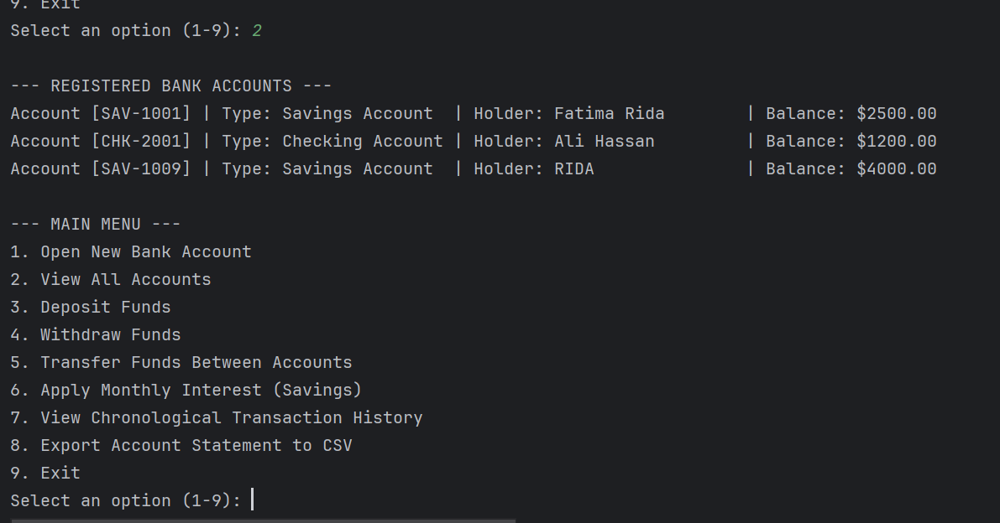
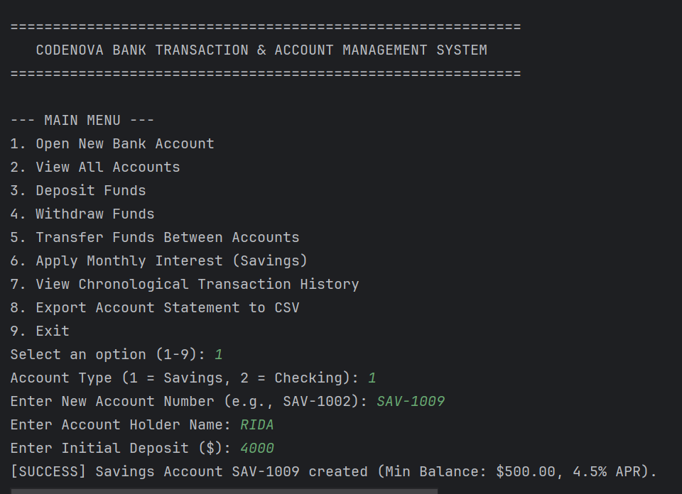
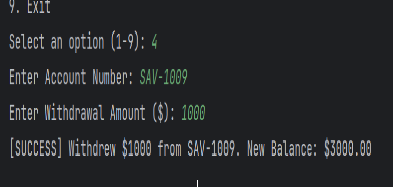
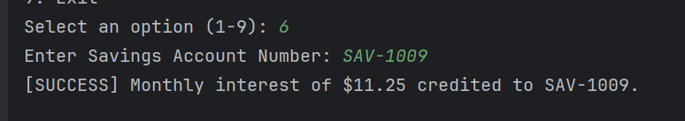
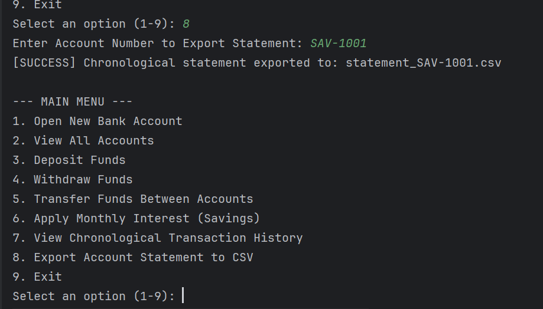

# CodeNova Bank Transaction & Account Manager

This is a Java console application built for Task 2 of the CodeNova Java Programming Internship (Batch 02). It manages bank accounts, checks balance rules before allowing transactions, handles errors safely, and saves account statements to a CSV file.

## Key Features & Rules

- Two Types of Bank Accounts (Encapsulation & Inheritance):
  - Savings Account: Requires a \$500.00 minimum balance at all times and earns 4.5% annual interest (credited monthly).
  - Checking Account: Allows daily deposits and withdrawals with up to \$300.00 in overdraft protection.
- Safe Money Transfers: Checks both accounts before moving money so funds are never lost or added twice if an error happens.
- Custom Exception Handling: Instead of crashing when someone enters bad data, the program shows a clear error message using custom exceptions:
  - InsufficientFundsException: Stops a withdrawal or transfer if it breaks the \$500 minimum balance or \$300 overdraft limit.
  - AccountNotFoundException: Alerts the user if the account number does not exist.
  - InvalidTransactionException: Blocks negative amounts, zero amounts, duplicate account numbers, or transfers to the same account.
- Exact Currency Math (BigDecimal): Uses Java's BigDecimal instead of regular decimals (double) so money calculations never have rounding errors.
- Transaction History & CSV Export: Saves every deposit, withdrawal, transfer, and interest payment with a date, time, and unique ID, and exports the full list to a CSV file.

## Tools & Technologies Used

- Java (JDK 17+)
- Java OOP (Abstract Classes, Inheritance, Encapsulation)
- Java Collections (Map and List to store accounts and transactions)
- BigDecimal & LocalDateTime (for money math and timestamps)
- File I/O (BufferedWriter to export CSV statements)
- IntelliJ IDEA

## Project Folder Structure

```text
CODENOVA-BANK-ACCOUNT-MANAGER/
├── src/
│   ├── exception/
│   │   ├── AccountNotFoundException.java
│   │   ├── InsufficientFundsException.java
│   │   └── InvalidTransactionException.java
│   ├── model/
│   │   ├── BankAccount.java
│   │   ├── CheckingAccount.java
│   │   ├── SavingsAccount.java
│   │   └── Transaction.java
│   ├── service/
│   │   └── BankService.java
│   └── ui/
│       └── Main.java
├── SCREENSHOTS/
│   ├── all-accounts.jpg
│   ├── NEW-BANK-ACCOUNT.jpg
│   ├── WITHDRAWAL.jpg
│   ├── interest.jpg
│   └── ACCOUNT-STATEMENT.jpg
├── statement_SAV-1001.csv
└── README.md
```

## How to Run the Project

1. Download or clone this repository:
```bash
git clone https://github.com
```
2. Open the project folder in IntelliJ IDEA.
3. Open src/ui/Main.java and click Run.
4. Use the numbered menu (1 to 9) in the console to create accounts, move money, test error checks, and export CSV statements.

## Output Screenshots

### 1. Viewing All Accounts


### 2. Opening a New Bank Account


### 3. Withdrawal & Minimum Balance Validation


### 4. Applying Monthly Interest


### 5. Transaction History & CSV Statement Export

